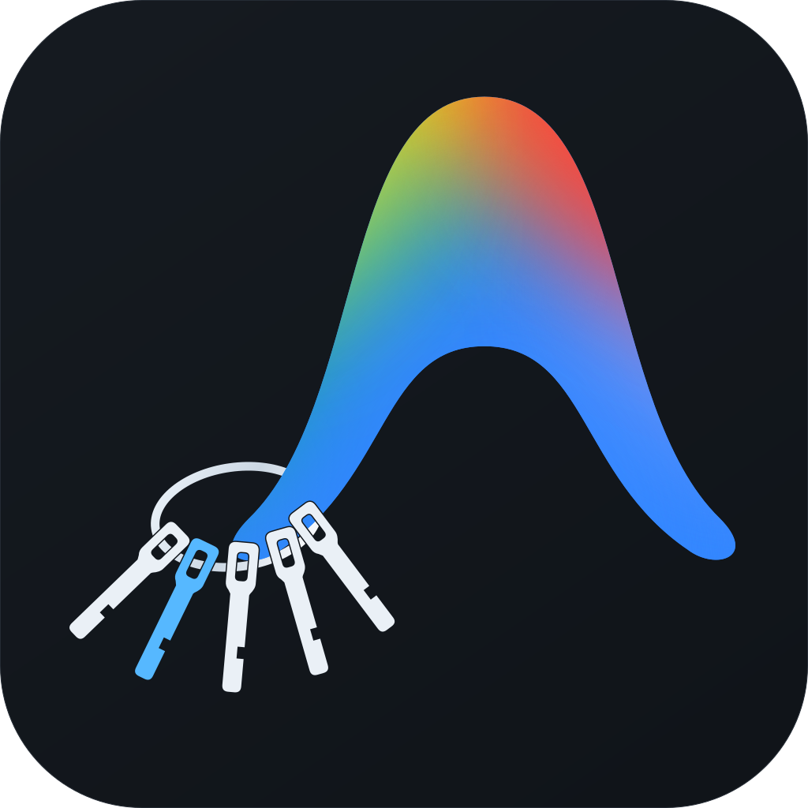

# Antigravity Account Manager

**A local account manager for Google Antigravity.**

Keep Google accounts, verification details, and subscription records in one desktop app. Account pools, OAuth refresh tokens, quota monitoring, and account switching are on the roadmap.

Antigravity 账号管家：本地管理账号、验证信息与会员记录，规划号池、令牌、额度管理与切号。

**English** | [简体中文](README.zh-CN.md)

[Features](#features) · [Roadmap](#roadmap) · [Getting started](#getting-started) · [Development](#local-development)

Windows desktop · Chinese interface · Active development

## Features

- **Accounts** — manage credentials and recovery details, search records, and import accounts from CSV.
- **Verification** — generate TOTP codes, organize Google backup codes, and maintain passkey and security key records. Passkey private keys are not stored.
- **Subscriptions** — manually record membership plans, status, dates, and costs.
- **Chrome profiles** — link existing browser profiles to accounts and open their Google account pages.
- **Local vault** — store records in a SQLCipher database protected by a master password, with manual and automatic locking. Light and dark themes are available.

Records are maintained locally; changing them does not update Google settings or verify membership status. Chrome profile launching does not switch the Antigravity client's account.

Encrypted backup export is available. Restoration has a known issue; see [Backup and known limitations](#backup-and-known-limitations) before using it.

## Roadmap

The next step is to bring account availability, authorization, and usage into the same workflow. The items below are planned and are not available in the current release.

- [ ] **Account pools** — group accounts and track availability and account health.
- [ ] **OAuth refresh tokens** — import authorizations, store refresh tokens, renew access tokens, and track expired or revoked access.
- [ ] **Quota monitoring** — view remaining quota, usage, and reset times.
- [ ] **Account switching** — switch Antigravity accounts through supported integration methods.
- [ ] **Quota-aware rotation** — choose accounts based on availability and remaining quota.
- [ ] **Subscription sync** — retrieve membership status where supported interfaces are available.
- [ ] **Backup and recovery** — fix restoration and improve export, import, and migration.
- [ ] **Bilingual interface** — add English, Simplified Chinese, and a saved language preference.

## Getting started

For an existing local portable build, open `dist-app/Antigravity Account Manager.exe`, or run `启动 Antigravity Account Manager.bat` in the same folder.

1. Create a master password on first use. Existing users keep their original master password.
2. Add an account, then enter its details in the security and subscription tabs.
3. Save your changes before switching accounts. The app offers save and discard options for unsaved edits.
4. Use the top bar to import data, open settings, change the theme, or lock the vault.
5. For browser integration, read the [Chrome profile guide](docs/chrome-profiles.en.md).

The current interface uses Chinese labels:

| On-screen label | Meaning |
| --- | --- |
| 新增 / 新增账号 | Add / add account |
| 安全性与登录 | Security and sign-in |
| Google AI 订阅 | Google AI subscription |
| 编辑 | Edit |
| 保存修改 | Save changes |
| 导入 | Import |
| 设置 | Settings |
| 锁定 / 解锁 | Lock / unlock |

Keep `libcrypto-4-x64.dll` and `WebView2Loader.dll` beside the executable. The target computer also needs the appropriate Windows / VC++ x64 runtime and WebView2. Local portable builds and DLLs in `dist-app/` are excluded from the source repository. To build your own executable, see the development instructions below.

## Data location and compatibility

The Windows app continues to use the original data location:

```text
%APPDATA%/AccountVault/
├── vault.db
└── vault.meta
```

`vault.db` is the encrypted database. `vault.meta` stores the salt and key derivation parameters needed to unlock it. When manually migrating files, close the app and preserve both files together from the same vault state.

The rename retains the `AccountVault` data directory, the `com.accountvault.desktop` application identifier, the existing theme preference key, and the `.acvault` format. These are compatibility identifiers, and existing vaults continue to use them.

## Backup and known limitations

- The database uses SQLCipher, master password keys are derived with Argon2id, and the backup wrapper uses AES-256-GCM.
- **The current `.acvault` restoration implementation has a database key and metadata consistency issue and is not a reliable migration method.** Successful export or outer decryption does not guarantee that the database can be opened afterward. Do not use Restore on your only vault until this is fixed.
- Backup export currently writes to `D:/account_vault_backup_YYYYMMDD.acvault`, without a save location picker. Export may fail if the drive is absent or unwritable; another export on the same day overwrites the same filename.
- Chrome manages profile cookies, extensions, browsing history, and sessions. This project stores profile paths. Opening a profile does not guarantee that the active Google website account matches the local record.
- Desktop behavior has not been validated across platforms. Chrome profile operations primarily target Windows.

## Local development

### Requirements

- Node.js and pnpm.
- Rust and a matching Windows C/C++ compiler toolchain. The existing local setup uses GNU / MinGW; native library architectures must match the Rust target.
- WebView2 for the desktop app, plus OpenSSL development libraries and the matching runtime for SQLCipher.

The existing working directory has machine-specific `.cargo/config.toml` and `src-tauri/.cargo/config.toml` files for Cargo output and OpenSSL paths. These files are excluded from source control. On another computer, configure `OPENSSL_DIR` for your environment and ensure the compiler can find the matching libraries. Cargo normally outputs to `src-tauri/target/`; `CARGO_TARGET_DIR` or `build.target-dir` overrides that location.

### Install dependencies and preview in a browser

Run from the project root:

```powershell
pnpm install --frozen-lockfile
pnpm dev --host 127.0.0.1
```

Open `http://127.0.0.1:1420/`. The browser preview uses temporary demonstration data that resets on refresh. Its lock screen password is `demo`. It is separate from the desktop vault, does not save real account data, and does not launch Chrome on your computer.

| Preview parameter | Purpose |
| --- | --- |
| `?theme=light` | Light theme |
| `?theme=dark` | Dark theme |
| `?locked=1` | Start at the demonstration lock screen |
| `?preview=components` | Preview component states |

### Run and build the desktop app

```powershell
# Start the desktop development app
pnpm dev:app

# Check TypeScript and build the frontend
pnpm build

# Build the Windows desktop executable
pnpm build:app
```

The executable is named `antigravity-account-manager.exe` and is written to the Cargo output directory under `release/`. For a portable distribution, it can be copied as `Antigravity Account Manager.exe` alongside the matching runtime libraries. The build uses `--no-bundle`, so it does not produce an installer.

### Existing desktop tests

```powershell
cargo test --manifest-path src-tauri/Cargo.toml --release --lib
```

Ensure that the matching OpenSSL DLL can be found at runtime. Existing tests cover encryption, parsing, and Chrome profile binding logic. Passing these tests does not resolve or validate the app's backup restoration flow described above.

## Project structure

```text
src/                       React interface and browser demonstration
  components/              Account forms, dialogs, and UI components
  context/                 Vault state and account editing flow
  services/                Tauri calls and preview data adapter
  utils/                   TOTP and clipboard utilities
src-tauri/                 Rust desktop backend
  src/                     Vault, encryption, imports, and Chrome profiles
  icons/                   Desktop icons
public/                    Static resources and component examples
docs/                      Supporting guides and GitHub presentation
README.md                  English overview and bilingual summary
README.zh-CN.md            Full Simplified Chinese documentation
DESIGN.md                  Interface design guidelines (Chinese)
Chrome配置绑定说明.md        Chrome profile guide (Chinese)
```

## Contributing and documentation

Issues and contributions in Chinese or English are welcome. Include reproduction steps, your environment, and expected behavior. Use fictional examples; do not include personal vaults, passwords, authenticator secrets, backup codes, or OAuth tokens in issues, screenshots, or commits.

Keep the English and Chinese README feature status, roadmap, and limitations aligned when changing behavior. GitHub About text, Topics, and bilingual search wording are provided in the [GitHub presentation guide](docs/GITHUB.md).

## About this project

Built with Tauri, React, TypeScript, and Rust. Previously named **Account Vault**. This is an independent community project and is not affiliated with or endorsed by Google.
